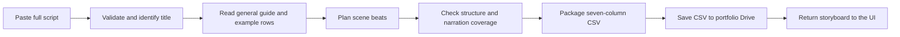

# Script to Storyboard


Script to Storyboard turns a complete narration script into a scene-by-scene plan for educational videos, explainers, documentaries, presentations, and other narration-led projects. It creates a storyboard and CSV; it does not generate images or animation.

> **Live demo:** The independent portfolio deployment is being prepared. Add the public URL here after the new Vercel project and workflow are verified.

## What it does

- Accepts a full script of up to 30,000 characters.
- Uses a general-purpose planning guide and original examples to help the model map the narration into visual scene beats.
- Preserves the spoken narration in order and reports a warning when scene coverage differs from the source.
- Returns the complete storyboard as a seven-column CSV.
- Shows the returned scenes in a scrollable preview and lets the user download the CSV.
- Saves a copy of the CSV in a dedicated portfolio Drive folder when the workflow is configured.

This project is storyboard-only. Background illustration, character design, image generation, and animation are outside its scope.

## Storyboard fields

| Column | What it contains |
| --- | --- |
| Scene | Consecutive scene number |
| Timecode | Supplied timing or an estimate based on narration length |
| Narration | Verbatim narration assigned to the scene |
| Visual Concept | The main visual idea or action |
| Setting | The environment or location |
| Illustration Elements | Objects, people, diagrams, and visual assets to draw |
| Direction Notes | Optional concise text, motion, or transition guidance |

## How a request moves through the workflow



The application sends the script to a dedicated n8n webhook. The workflow reads only its independent portfolio guide and examples, plans the storyboard, checks the structured result, builds a CSV, and saves it in the portfolio output folder. The app displays the returned rows and provides a local CSV download.

## Data handling

The complete script is sent to the configured n8n webhook and processed by the connected AI model. The generated CSV is also saved in the project owner's Google Drive folder. A visitor can download a local copy from the UI; the Drive folder is restricted to its owner and workflow account. Do not use the public demo for confidential scripts.

## Use the demo

1. Open the live demo once its deployment URL is added above.
2. Paste the complete narration or select **Load sample**.
3. Choose **Create storyboard** and wait for the scene plan.
4. Review the narration, visual concepts, settings, illustration elements, and notes.
5. Download the CSV or open the saved Drive output when the workflow confirms a successful upload.

## Technology

| Part | Technology |
| --- | --- |
| Frontend | Static HTML, CSS, and JavaScript |
| Workflow | n8n webhook and connected AI/model nodes |
| Planning references | Independent Google Docs guide and Google Sheets examples |
| Output | CSV download and Google Drive file |
| Hosting | Vercel (configured after the independent public project is approved) |

## Run locally

Serve this folder from a static web server:

```sh
python -m http.server 4173
```

Open `http://localhost:4173`. The browser sends requests to the portfolio n8n webhook configured near the top of `app.js`. For a different n8n instance, update `WEBHOOK_URL` and add the exact site origin to that workflow's CORS allowlist.

## Requirements for a working deployment

- The dedicated portfolio n8n workflow must be published and active.
- The webhook URL in `app.js` must match that workflow's production webhook.
- The workflow must allow the deployed site origin through CORS.
- Its Google Docs, Sheets, and Drive nodes need working credentials and access to the new portfolio resources.

Do not commit exported workflow data containing account identifiers, credential references, private resource IDs, or authentication material. Configure those values in the n8n instance.

## Limitations

- When the source has no timing marks, the workflow estimates timecodes from narration length. Treat them as a first pass.
- AI scene divisions and visual concepts need editorial review before production.
- Requests can take time because the model plans the full script in one workflow run.
- The browser currently supports scripts up to 30,000 characters.
- A CSV save failure is surfaced as a workflow error rather than reported as success.

## Project structure

```text
/
├── app.js
├── favicon.svg
├── index.html
├── styles.css
└── docs/
    └── images/
        └── script-to-storyboard-cover.png
```

## Author

Built by Rayvin Gianan.
