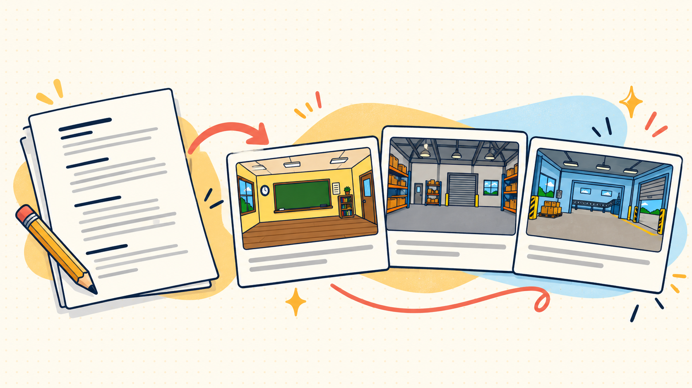
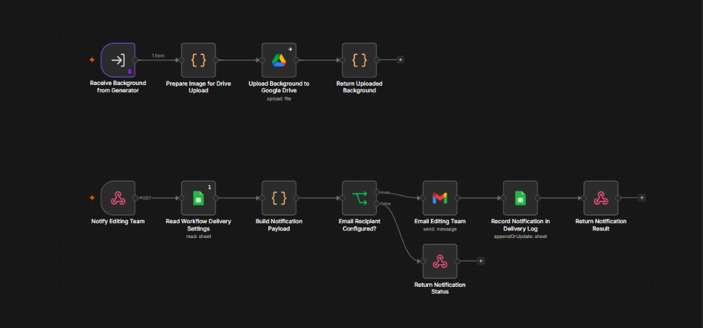
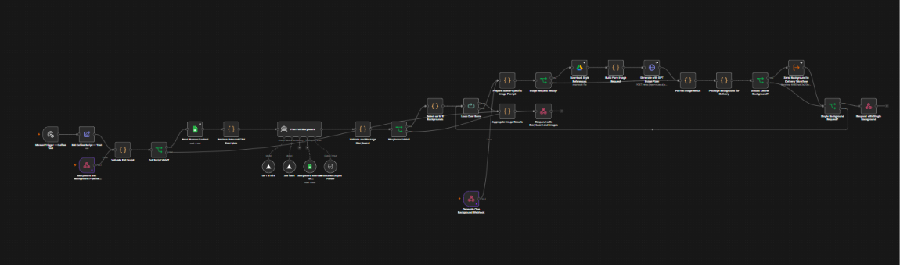

# Script to Storyboard Lab

Turn a complete narration script into an animator-ready storyboard, then generate up to six matching background images.

**[Open the live demo](https://script-to-storyboard-six.vercel.app/)**

The live Vercel page was checked during the latest successful run. It displayed the complete storyboard, six generated background plates, Drive links, and the editing-team notification status.

## Overview

The demo helps animators start with a scene plan that follows the narration. The planning model reads the approved storyboard examples and style notes from Google Sheets, creates the full CSV storyboard, and selects up to six distinct settings for background generation. The image model then creates one full-frame background at a time in the same hand-drawn 2D art treatment.

The backgrounds contain environments only. Animators add characters, movable props, diagrams, on-screen words, and motion by hand.

## Project Snapshot

- One complete script becomes a scene-by-scene storyboard.
- The storyboard uses eight fixed CSV columns and keeps the voiceover in order.
- Missing timing information is estimated from the narration.
- Up to six unique settings become full-frame, 16:9 background images.
- PNG files are uploaded to Google Drive as they are generated.
- The UI shows the storyboard CSV download and individual background previews and Drive links.
- The Notify editing team action saves the CSV to Drive, records the delivery in Google Sheets, and emails the configured recipient.

## Workflow Overview

1. **Paste a complete script.** The first non-empty line is used as the script title for the run and output filenames.
2. **Build the storyboard.** The text planner uses the Google Sheets reference material and returns the entire scene plan as CSV.
3. **Generate backgrounds.** The planner selects up to six distinct settings. Each setting is sent to the image model in its own sequential request.
4. **Upload and return images.** A connected delivery workflow saves each PNG to Drive, then returns the image and Drive link to the UI.
5. **Hand off the run.** Download the CSV from the UI. When ready, select Notify editing team to upload the CSV, write the process log row, and email the title, date, storyboard link, and background links.

## Storyboard Format

The CSV columns are kept in this exact order.

| Column | What it contains |
| --- | --- |
| Scene | Sequential scene number |
| Timestamp | Supplied timing, or an estimated continuous range |
| Voiceover | The complete narration for the scene |
| What's happening | The visible beat in the scene |
| Background | A specific setting and composition |
| Hand-drawn characters & props | Elements for animators to draw |
| On-screen text | Words that appear on screen |
| Transitions/Motion | Short animator-facing notes such as "Hard cut" or "Zoom on icon" |

## Tools Used

| Tool | Role |
| --- | --- |
| n8n | Orchestrates planning, image generation, Drive delivery, and email steps |
| OpenAI GPT-5 mini through Vercel AI Gateway | Plans the storyboard from the complete script and reference examples |
| OpenAI GPT Image 2.5 Flare through OpenRouter | Generates one background image per request |
| Google Sheets | Stores storyboard examples, planner context, delivery settings, and the process log |
| Google Drive | Stores approved visual references, generated PNG files, and storyboard CSV files |
| Gmail | Sends the editing-team handoff email |
| Vercel | Hosts the web interface |

## How to Use the Demo

1. Open the [live demo](https://script-to-storyboard-six.vercel.app/).
2. Paste the complete narration. Put a short topic title on the first non-empty line.
3. Select **Create storyboard & backgrounds** and wait for the storyboard and image batch to finish.
4. Review the CSV and each generated background. Use the Drive links to open the saved PNG files.
5. Select **Download storyboard CSV** to save a local copy.
6. Select **Notify editing team** when ready to send the handoff. This action stores the storyboard CSV in Drive, appends a process record to Google Sheets, and sends the configured email.

## Output Naming

The title is derived from the first non-empty script line and converted to a lowercase slug.

- Background PNG: YYYY-MM-DD-title-slug-bg001-scenes-01.png
- Storyboard CSV: title-slug-storyboard.csv

For example, a script titled "The Journey of a Raindrop" produces filenames similar to 2026-10-22-the-journey-of-a-raindrop-bg001-scenes-01.png and the-journey-of-a-raindrop-storyboard.csv.

## Storage and Access

Google Sheets and Google Drive are the persistent storage services. The reference examples, planner context, workflow settings, and process log are in Google Sheets. Approved visual references and generated files are in Google Drive. No n8n Data Tables or workflow memory are used for persistent storage.

The current demo is connected to the project owner's Google accounts. Drive file visibility follows the output folder's sharing settings; share that folder with any animator who needs to open its files. The editing-team recipient is configured through the Workflow Settings sheet.

## Current Demo Scope

- The full storyboard is created before background generation begins.
- Image generation is capped at six backgrounds per script in this demo.
- Generated images are clean, empty environments: no characters, text, movable props, diagrams, or animation marks.
- The art style remains consistent while setting, palette, and composition follow each scene.
- Storyboard and background generation are sequential. If a request times out, check its n8n execution before submitting again to avoid duplicate work.

## Workflow Screenshots

### Storyboard and Background Generation

### Drive Delivery and Email Notification

## Repository Structure

- public — Vercel web interface
- workflows/script-to-storyboard-generation — active storyboard and background generation workflow export
- workflows/script-to-storyboard-delivery — active Drive delivery and notification workflow export
- docs — operating notes, storyboard rules, screenshots, and the quick guide

## Files for the Animation Team

The short guide is available at [docs/Script-to-Storyboard-Quick-Guide.docx](docs/Script-to-Storyboard-Quick-Guide.docx). It contains the live demo link, the workflow steps, the storyboard format, and the animator handoff notes.

## Author

Rayvin Gianan  
AI Automation Specialist  
Portfolio: https://rayvingianan.r4yv.tech
