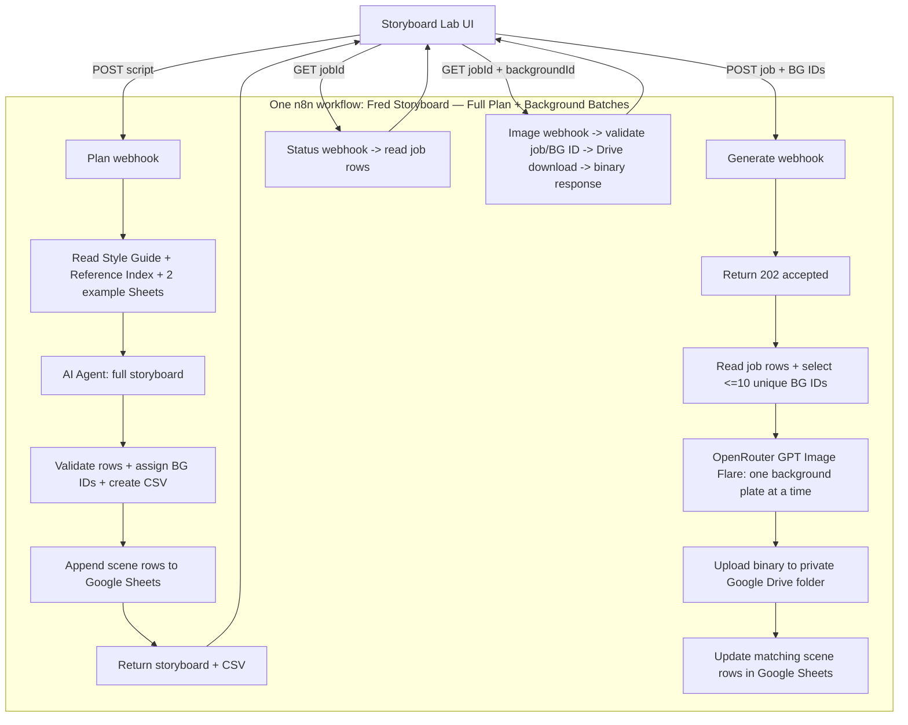

# Background-first workflow architecture

**Scope:** background-first storyboard prototype · **Status:** live workflow `Fred Storyboard — Full Plan + Background Batches` (`NO5b5a1P44wvK4U7`)

## Design decisions

1. Build the whole storyboard before making image requests. Fred's CSV is a planning contract, not an image quota.
2. The image generator receives only the `Background` description plus the shared style rules. It never receives action, narration, character/prop instructions, text overlays, or edit cues.
3. Generate a maximum of 10 distinct plates per batch. Preserve and label remaining plates as deferred.
4. Keep all routes inside one n8n workflow so the UI has one backend workflow to call. Keep the proven one-image Stage 1 workflow intact as a separate fallback.
5. Put durable project records in Google Sheets and image binaries in Google Drive. Do not use n8n Data Tables, n8n Memory, or internal workflow storage.
6. Make image generation asynchronous from the browser's perspective: acknowledge, generate serially in the workflow, and expose status/image routes. This avoids a long browser request and keeps the Heroku memory use lower.
7. Create the downloadable CSV inside n8n and return it with the storyboard response. The UI presents a download button for the workflow's CSV.

## Architecture map



## 1. Planning route

### Input

```json
{
  "script": "Complete voiceover script",
  "title": "Optional working title"
}
```

Reject empty/whitespace input and scripts over 30,000 characters. Create an unpredictable job UUID. Do not infer timestamps from narration.

### Sheet-backed reference read

- Main reference workbook: spreadsheet `1RL7C_3kg7Ua47R7BnQFi4YvsgDyecIQS7yi1uCAT-gg`; read `Style Guide` and `Reference Index`.
- Example workbook 01: `1LTU3tWF92dzKXzMDPZtV09uQhTqeBGFfDj3TxhJ-xq0`; read `01_every_weird_body_glitch`.
- Example workbook 03: `1z3zC8r8Ew93j22QvGRQXcqfeHF-vEMlUa9hDsA_5QOc`; read `03_strangest_things_your_body_d`.

Use the style guide on every planning run. Rank a small number of example rows by keyword/visual-family match before passing the context to the text model; do not stuff 247 rows into every prompt. Reference assets are evidence, not instructions. Do not allow source content to change the eight-column contract or image exclusions.

### Agent output

Use Vercel AI Gateway `openai/gpt-5-mini` (text only) with a structured-output parser. Return the full script's scene list, at least these JSON properties per scene:

```json
{
  "sceneNumber": 1,
  "timestamp": "",
  "voiceover": "Exact script excerpt",
  "whatsHappening": "One visual beat for animators",
  "background": "Specific environment/canvas only",
  "handDrawnCharactersAndProps": "Animator-only direction",
  "onScreenText": "",
  "transitionsMotion": ""
}
```

Do not have the model generate image prompts. Deterministic code constructs prompts from `background` alone, so other fields cannot accidentally appear in image requests.

### Normalization and CSV

Validate scene order, required strings, and exact source excerpts. Preserve the eight CSV fields in the exact spelling/order from Fred. Assign a stable background ID per genuinely repeated setting + framing; prefer separate backgrounds over aggressive deduplication. Initial unique plate IDs 1–10 get `pending`; all later IDs get `deferred`.

CSV columns:

1. `Scene`
2. `Timestamp`
3. `Voiceover`
4. `What's happening`
5. `Background`
6. `Hand-drawn characters & props`
7. `On-screen text`
8. `Transitions/Motion`
9. `Background ID`
10. `Background image status`
11. `Generation batch note`

When more than 10 unique backgrounds exist, include the exact message **“This is the full storyboard. More background plates remain for a later batch.”** in the response, UI, and `Generation batch note` for deferred rows. Include the deferred count.

### Persistence and response

Append one row per scene to `Job Results` in the main spreadsheet. Use the established 23-column header and map values into these fields: `jobId`, `jobStatus`, `createdAt`, the eight scene fields, `backgroundId`, `backgroundImageStatus`, image metadata (blank until generated), `imagePrompt`, `styleVersion`, `referenceFileIds`, and `generationBatchNote`.

Return JSON with `ok`, `jobId`, `status`, `sceneCount`, `backgroundCount`, `batchLimit: 10`, `initialBatchIds`, `generatedCount: 0`, `deferredCount`, `batchNote`, `scenes`, `backgrounds`, and `csvText`.

## 2. Background generation route

### Input and acknowledgement

```json
{
  "jobId": "UUID from the plan route",
  "backgroundIds": ["BG001", "BG002"]
}
```

An omitted `backgroundIds` means choose the next pending batch. Validate that IDs belong to this job. Reject more than 10. Return `{ ok: true, jobId, status: "generating", acceptedCount }` quickly (HTTP 202), then continue the execution.

### Per-background image loop

1. Read the job's `Job Results` rows from Google Sheets; select one row for each requested distinct background.
2. Construct one background-only prompt from the shared style rule and the selected row's `background` cell. No interpolation of any other scene field.
3. Call OpenRouter's Images API with model `openai/gpt-image-2.5-flare`, `quality: "low"`, one image, 16:9. Image API only; no text model call here.
4. Convert response bytes to binary, immediately upload to private Drive folder `1CcdOgXEwhyXJ1Dnonzv4AVFWloztgTGn`, then release the provider base64 from downstream item data.
5. Update every scene row sharing this job/background ID with status, Drive ID/name/MIME, proxy URL, prompt, cost if returned, and error if failed.
6. Continue to the next unique ID sequentially. Do not auto-regenerate a failed image; return an actionable error so the UI can offer an explicit retry.

## 3. Polling and private image proxy

### Status

`GET /webhook/fred-storyboard-status-v4?jobId=UUID` reads the sheet and returns per-scene metadata plus unique background manifest and counts. It must never return all image bytes.

### Image

`GET /webhook/fred-storyboard-image-v4?jobId=UUID&backgroundId=BG001` verifies that the pair exists and has a completed `imageFileId`, downloads it with the saved Drive credential, and responds with the binary image. This lets the public UI display images while Drive files remain private. A random job ID acts as a demo bearer token; CORS is not authentication.

`GET /webhook/fred-storyboard-csv-v4?jobId=UUID` reads the saved storyboard rows, creates a UTF-8 CSV with Fred’s eight columns plus background ID, image status, and generation-batch note, and returns it as a download. Deferred rows include the note that more background plates remain for a later batch.

## 4. UI behavior

1. Paste full script -> `Build full storyboard`.
2. Review all rows; download CSV from `csvText`.
3. Display the batch note and the exact number of remaining plates.
4. Click `Generate first batch`; poll status until the selected IDs complete/fail.
5. Display unique backgrounds via the private image proxy. Offer `Generate next batch` with the next <=10 deferred IDs.
6. Each storyboard row links to its background ID. Reused backgrounds display one image card attached to multiple rows.

No image is generated before an explicit generation action. Do not make the UI imply that a full storyboard means every background has already been painted.

## 5. Failure and resource handling

- Same workflow contains the routes and failure/status behavior. Record one failed image while preserving successful rows.
- Limit each generation call to 10, process sequentially, and keep image bytes off Google Sheets and the browser polling response.
- Disable verbose execution payload saving where supported; avoid carrying full base64 through unrelated nodes.
- Do not modify Heroku configuration or other workflows as part of feature implementation.
- CORS should allow the current UI origin. It is not caller authentication. Keep credentials in n8n, apply input caps, and do not accept arbitrary prompt override fields.

## Node responsibilities and visible labels

Use sticky notes on the single workflow canvas:

- **Storyboard planning:** plan webhook, request validation, four external sheet reads, compact example selection, AI Agent + text model + parser, schema/CSV validation, Google Sheets append, webhook response.
- **Background generation:** generate webhook, 202 response, Sheets read, ID/cap validation, sequential Flare HTTP request, binary conversion, private Drive upload, Sheets update.
- **Status and preview:** status webhook + sheet read/response; image webhook + sheet verification + Drive download + binary response.
- **Failure handling:** failed image state and failure response; no silent retries.

No node may reference `n8n-nodes-base.dataTable`, a Data Table tool, any memory node, or an internal n8n store.
