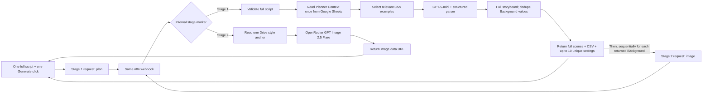

# Current Workflow Architecture — One Script, Background Plates

This file now describes the simplified implementation and supersedes the older `v4` planning/storage/delivery architecture. See [`fred-agent-context.md`](fred-agent-context.md) for the product rules and source references.

## Sequence



There is one user input and one Generate action: the full script. The workflow always plans the complete storyboard first and returns all scenes plus CSV data. The browser then orchestrates the image loop and displays each plate as it completes. The user never chooses a plan-only or image-only mode, and n8n never holds a multi-image batch in one execution.

## Webhook contract

Both calls use `POST /webhook/fred-image-generation-stage-1` with `Content-Type: text/plain;charset=UTF-8` to avoid a browser preflight. The JSON text body includes an `action` discriminator.

### Plan once

```json
{"action":"plan","script":"The complete narration script..."}
```

The plan branch validates 20–30,000 characters. It reads `Planner Context` from the external reference workbook once, ranks up to 10 relevant rows from each example CSV, sends the full script and compact reference context to `openai/gpt-5-mini`, and parses the full storyboard. The packaging node preserves every scene, builds Fred’s eight-column CSV, groups matching `Background` values, and returns at most 10 unique backgrounds. The `action` value only identifies which internal stage the browser is requesting.

Expected response:

```json
{
  "ok": true,
  "totalScenes": 20,
  "totalUniqueBackgrounds": 12,
  "generatedBackgroundLimit": 10,
  "remainingBackgrounds": 2,
  "scenes": [
    {"sceneNumber":1,"timestamp":"00:00-00:05","voiceover":"...","whatsHappening":"...","background":"White background","handDrawnCharactersAndProps":"...","onScreenText":"...","transitionsMotion":"..."}
  ],
  "storyboardCsv": "Scene,Timestamp,Voiceover,What's happening,Background,Hand-drawn characters & props,On-screen text,Transitions/Motion\\r\\n...",
  "backgrounds": [
    {"backgroundId":"BG001","sceneNumbers":[1,8],"backgroundPrompt":"White background"}
  ]
}
```

The complete storyboard and CSV are returned alongside the unique Background entries. The image limit does not truncate the story plan; the UI displays the full scene table and offers the CSV for download.

### Generate one image

```json
{"action":"image","background":"Warm yellow living room with a green sofa, one plant, and a landscape picture","backgroundId":"BG001","sceneNumbers":[2,6]}
```

The image branch combines the Background value with fixed art-style constraints, downloads one style reference from Drive, and calls `openai/gpt-image-2.5-flare` through OpenRouter’s Images API. Use `quality: "low"`, `aspect_ratio: "16:9"`, and `n: 1`. Return one image data URL and optional reported cost. No text-model call occurs in this branch.

## Limits and error handling

- Up to 10 unique images per script, requested sequentially by the browser.
- Each image is one independent n8n execution; do not create an n8n loop or parallel branch.
- No script/job/image persistence; the external Planner Context sheet is read-only.
- If planning fails, make no image calls. If an image fails, preserve completed gallery cards and stop the remaining sequence. Do not retry automatically.
- Bounded Google Sheets retries are configured on the planner read. Report rate-limit failures clearly.
- No n8n Data Tables, n8n Memory, SVG export, Drive uploads, email/Slack notifications, or review feedback in this stage. CSV text is returned in the planner response and not stored.
